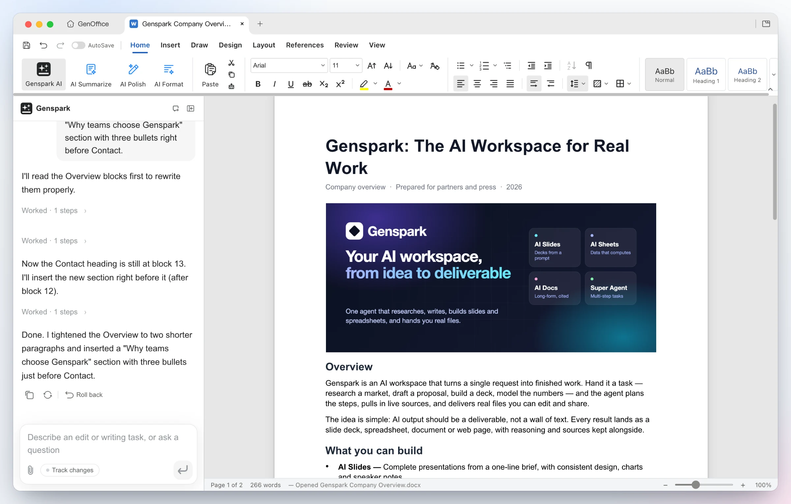
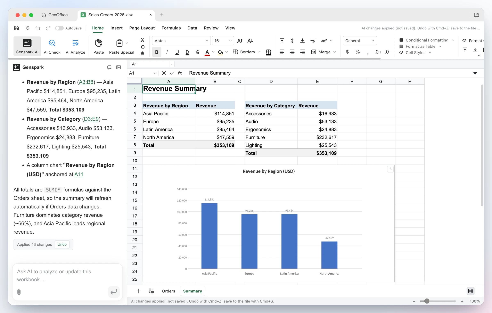
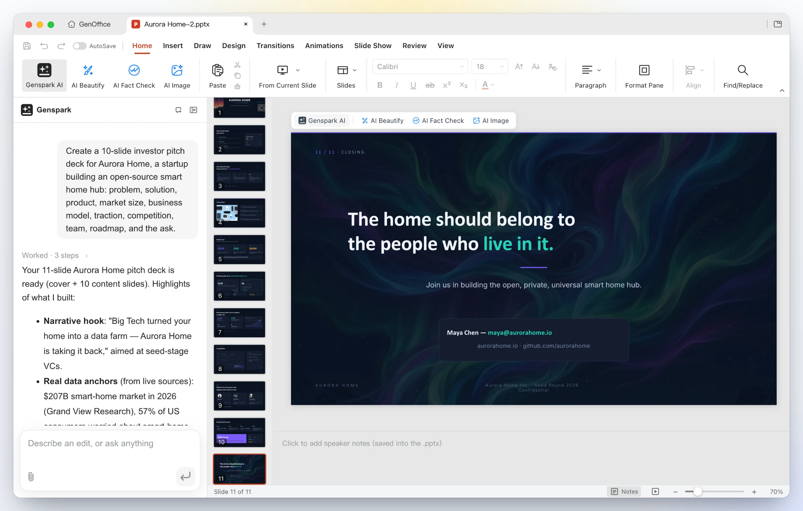
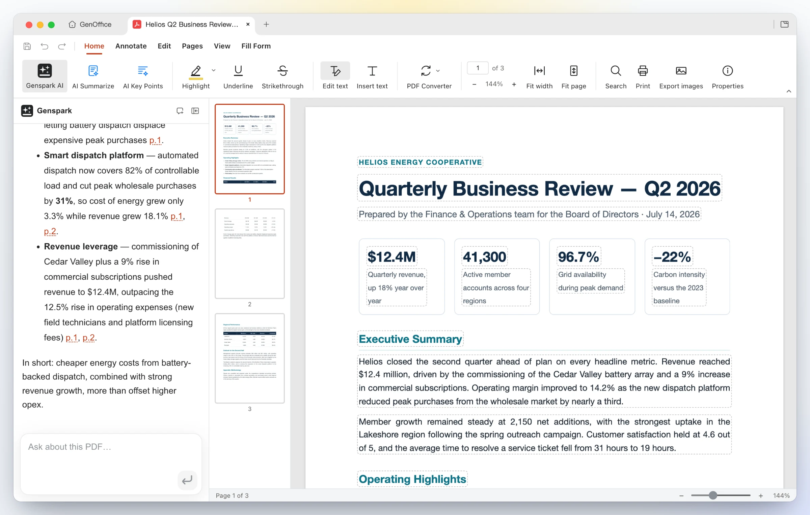
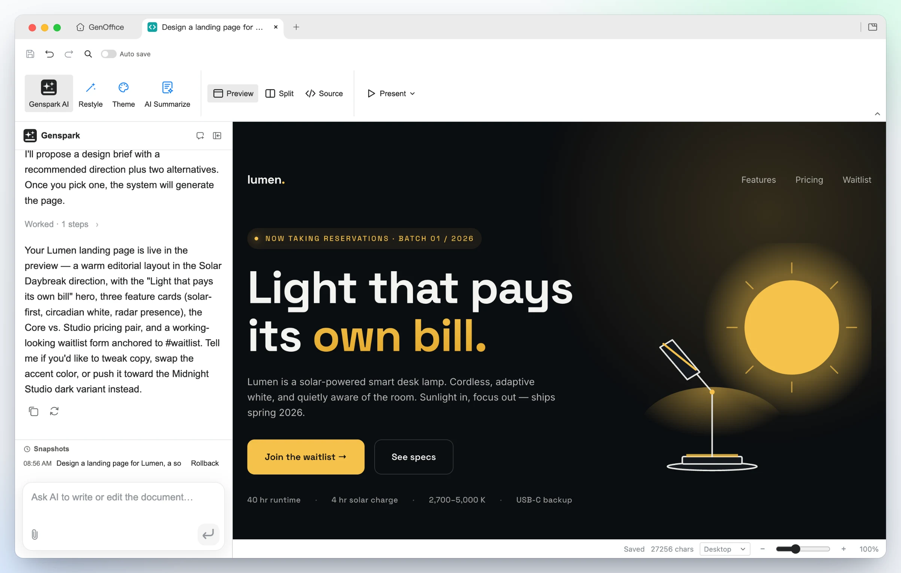
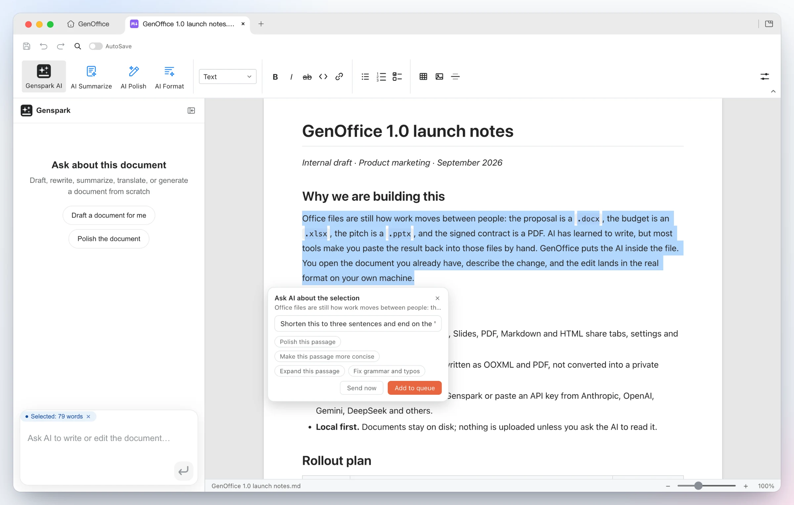

<p align="center"><a href="../../README.md">English</a> · <a href="README.es.md">Español</a> · <a href="README.pt-BR.md">Português (Brasil)</a> · <a href="README.de.md">Deutsch</a> · <a href="README.fr.md">Français</a> · <a href="README.zh-CN.md">简体中文</a> · <a href="README.zh-TW.md">繁體中文</a> · <a href="README.ko.md">한국어</a> · <a href="README.ja.md">日本語</a> · <a href="README.ar.md">العربية</a> · <a href="README.ru.md">Русский</a> · <a href="README.it.md">Italiano</a> · <a href="README.nl.md">Nederlands</a> · <a href="README.pl.md">Polski</a> · <a href="README.cs.md">Čeština</a> · <a href="README.id.md">Bahasa Indonesia</a> · <a href="README.ms.md">Bahasa Melayu</a> · <a href="README.th.md">ไทย</a> · <a href="README.hi.md">हिन्दी</a> · <a href="README.he.md">עברית</a> · <b>Tiếng Việt</b></p>

# HermesOffice

**Bộ ứng dụng văn phòng AI mã nguồn mở đầy đủ tính năng đầu tiên trên thế giới.**

[](https://github.com/criptogus/HermesOffice/blob/main/LICENSE) [](https://github.com/criptogus/HermesOffice/releases/latest) [](https://github.com/criptogus/HermesOffice/releases)

[Tải về](https://github.com/criptogus/HermesOffice/releases/latest) · [Quyền riêng tư](https://github.com/criptogus/HermesOffice/blob/main/PRIVACY.md) · [Demo](https://www.youtube.com/watch?v=B2pLdMX95v4)

HermesOffice là giải pháp thay thế miễn phí, mã nguồn mở cho Microsoft Office trên macOS,
Windows và Linux, được xây dựng với việc chỉnh sửa bằng AI là quy trình cốt lõi chứ không
phải một khung chat gắn thêm. Ứng dụng mở và lưu các định dạng Microsoft Office thực sự —
Word (`.docx`), Excel (`.xlsx`), PowerPoint (`.pptx`) — và cũng chỉnh sửa được PDF và Markdown:
một trình xử lý văn bản, bảng tính, trình soạn bài thuyết trình, trình chỉnh sửa PDF và trình
soạn Markdown dưới dạng sáu ứng dụng Electron dùng chung một tầng engine.

[](https://www.youtube.com/watch?v=B2pLdMX95v4)

[Xem video demo trên YouTube](https://www.youtube.com/watch?v=B2pLdMX95v4)

## Tính năng

- **Chỉnh sửa PDF thực thụ** — gõ lại văn bản và chỉnh sửa hình ảnh ngay trên trang, giữ nguyên phông chữ gốc.
- **Chuyển đổi PDF → Word / PowerPoint / Excel cục bộ** — biến PDF thành `.docx`, `.pptx` hoặc `.xlsx` có thể chỉnh sửa hoàn toàn trên máy của bạn: không cloud, không tải lên.
- **Cả PDF quét (scan)** — trên macOS và Windows, các trang quét được đọc bằng OCR của hệ thống nên có thể chuyển thành văn bản chỉnh sửa được.
- **Chỉnh sửa `.docx` tương thích Microsoft Word, bảo toàn từng byte** — chỉ phần bạn chạm vào mới thay đổi; Word sẽ không nhận ra gì cả.
- **Phân trang trung thực với Word** — ngắt trang rơi đúng chỗ Word đặt.
- **Bảng tính tương thích Excel** — engine tự phát triển kèm sidecar `.xlsx` bằng Rust, biểu đồ riêng, pivot table, slicer.
- **Bài thuyết trình tương thích PowerPoint** — engine `.pptx` tự phát triển với master, layout, đường gióng thông minh, cắt ảnh không phá hủy.
- **Markdown sang Word, hoàn toàn cục bộ** — dùng cùng engine OOXML, không Pandoc, không cloud.
- **AI chỉnh sửa tài liệu** — chỉnh sửa theo từng khối kèm snapshot và diff, các agent hiểu tài liệu.
- **Dùng khóa API của riêng bạn (BYOK)** — chạy AI bằng khóa API của bạn: Claude, OpenAI, Gemini, DeepSeek, Kimi, GLM, Qwen, Doubao, MiniMax, Grok, Mistral, OpenRouter, hoặc bất kỳ endpoint tương thích OpenAI nào — hoặc đăng nhập bằng Genspark và bỏ qua việc nhập khóa.
- **Tích hợp sẵn công cụ cho agent** — tìm kiếm web/hình ảnh, tạo ảnh, phân tích media.
- **Giao diện sáng / tối / theo hệ thống.**
- **macOS, Windows, Linux.**
- **Miễn phí & mã nguồn mở (Apache-2.0).**

## Tải về

**macOS · Apple Silicon — [tải bản `.dmg` mới nhất](https://github.com/criptogus/HermesOffice/releases/latest/download/HermesOffice-arm64.dmg)** Một cú nhấp, luôn là bản dựng mới nhất. Liên kết này không bao giờ thay đổi — đây cũng là liên kết nên dùng để chia sẻ hoặc đặt lên một trang web.

| Nền tảng                             | Yêu cầu                      | Tải về                                                                                                                                                                                                   |
| ------------------------------------ | ---------------------------- | -------------------------------------------------------------------------------------------------------------------------------------------------------------------------------------------------------- |
| **macOS** — Apple Silicon (arm64)    | macOS 11+                    | [`.dmg`](https://github.com/criptogus/HermesOffice/releases/latest/download/HermesOffice-arm64.dmg) · [`.zip`](https://github.com/criptogus/HermesOffice/releases/latest/download/HermesOffice-arm64-mac.zip) |
| **macOS** — Intel (x64)              | macOS 11+                    | [tự biên dịch từ mã nguồn](#phát-triển) — chưa có bản dựng phát hành                                                                                                                                      |
| **Windows** (x64)                    | Windows 10+                  | [tự biên dịch từ mã nguồn](#phát-triển) — chưa có bản dựng phát hành                                                                                                                                      |
| **Linux** — Debian / Ubuntu          | x86\_64, glibc 2.34+         | [tự biên dịch từ mã nguồn](#phát-triển) — chưa có bản dựng phát hành                                                                                                                                      |
| **Linux** — Fedora / RHEL / openSUSE | x86\_64, glibc 2.34+         | [tự biên dịch từ mã nguồn](#phát-triển) — chưa có bản dựng phát hành                                                                                                                                      |
| **Linux** — các bản phân phối khác   | x86\_64, glibc 2.34+, FUSE 2 | [tự biên dịch từ mã nguồn](#phát-triển) — chưa có bản dựng phát hành                                                                                                                                      |

Các bản dựng được tạo từ nhánh `main`. Gói macOS được **ký ad-hoc, chưa được notarize** (hiện chưa có
Apple Developer ID đứng sau), nên lần khởi chạy đầu tiên cần một bước xác nhận: nhấp chuột phải vào
ứng dụng → **Open**, hoặc cho phép trong **System Settings → Privacy & Security**.

Các phiên bản cũ hơn có trên trang [Releases](https://github.com/criptogus/HermesOffice/releases).

### Bản Nightly — được xây dựng trên mỗi lần push vào `main`

Bản dựng nightly được phát hành tự động sau mỗi commit vào nhánh `main` và chứa các tính năng cùng bản sửa lỗi mới nhất. Bạn có thể tải về từ [GitHub Releases (Nightly)](https://github.com/criptogus/HermesOffice/releases).

### Cài đặt trên Linux

Gói deb được cài bằng apt — nó sẽ kéo theo các thư viện phụ thuộc và thêm HermesOffice
vào menu ứng dụng:

```
sudo apt install ./hermesoffice_<version>_amd64.deb
```

Trên Fedora / họ RHEL / openSUSE, hãy cài gói rpm:

```
sudo dnf install ./hermesoffice-<version>.x86_64.rpm     # Fedora / RHEL family
sudo zypper install ./hermesoffice-<version>.x86_64.rpm  # openSUSE
```

AppImage thì chạy trực tiếp tại chỗ: cài runtime FUSE 2
(`sudo apt install libfuse2`; trên Ubuntu 24.04 gói này là `libfuse2t64`),
cấp quyền thực thi cho tệp, rồi chạy:

```
chmod +x HermesOffice-<version>.AppImage
./HermesOffice-<version>.AppImage
```

## Ảnh chụp màn hình (Screenshots)

| Docs — Chỉnh sửa AI                        | Sheets — Trợ lý AI                              | Slides — Tạo slide bằng AI                      |
| ------------------------------------------- | ----------------------------------------------- | ----------------------------------------------- |
|    |    |    |

| PDF — Chỉnh sửa văn bản thực sự             | HTML — Tái định dạng AI                         | Markdown — Bảng điều khiển AI                   |
| ------------------------------------------- | ----------------------------------------------- | ----------------------------------------------- |
|  |        |  |

## Các ứng dụng

| Ứng dụng        | Sản phẩm                  | Mô tả                                                                                                                                                                                                    |
| --------------- | ------------------------- | -------------------------------------------------------------------------------------------------------------------------------------------------------------------------------------------------------- |
| `apps/docs`     | **HermesOffice Docs**     | Trình xử lý văn bản `.docx`. Vòng đọc-ghi bảo toàn từng byte: chỉ các đoạn đã bị thay đổi (dirty) mới được tạo lại (paragraph patch), mọi thứ khác trong tệp gốc được giữ nguyên từng byte, nên việc mở rồi lưu không bao giờ làm hỏng bố cục trong Word. Chế độ xem phân trang với các số đo dòng tái tạo đúng bố cục của tài liệu gốc, theo dõi thay đổi, bình luận, style, công thức, nét vẽ tay (ink). |
| `apps/sheets`   | **HermesOffice Sheets**   | Bảng tính `.xlsx`. Giao diện xây dựng trên lõi mã nguồn mở [Univer](https://github.com/dream-num/univer) (Apache-2.0) cùng một lớp mở rộng tự phát triển lớn; nhập/xuất `.xlsx` chạy qua sidecar Rust tự phát triển (calamine + IronCalc), biểu đồ được vẽ riêng (Konva), cùng pivot table, slicer, định dạng có điều kiện và truy vết công thức. |
| `apps/slides`   | **HermesOffice Slides**   | Bài thuyết trình `.pptx`. Engine phân tích/hiển thị/chỉnh sửa `.pptx` tự phát triển với master, biểu đồ, cắt ảnh, nét vẽ tay và định hình văn bản (số đo HarfBuzz).                                         |
| `apps/pdf`      | **HermesOffice PDF**      | Trình xem/chỉnh sửa `.pdf` dựa trên [pdf.js](https://github.com/mozilla/pdf.js) (Apache-2.0) + [pdf-lib](https://github.com/Hopding/pdf-lib) (MIT): chú thích, biểu mẫu, mục lục, tem, chữ ký, thao tác trang và hỗ trợ in. Chỉnh sửa văn bản thực sự — chọn theo đoạn với reflow trong khối, khôi phục căn lề, giữ nguyên phông chữ gốc — cùng chèn/chỉnh sửa ảnh trong content stream, tất cả bằng cách ghi lại content stream của trang qua [PDFium](https://pdfium.googlesource.com/pdfium/) wasm (BSD-3-Clause) với phông chữ nhúng dạng subset — không dùng chú thích che phủ. Chuyển PDF thành tệp Word, PowerPoint và Excel chỉnh sửa được hoàn toàn cục bộ (`packages/pdf2docx`), có hỗ trợ OCR cho trang quét (OCR của hệ thống trên macOS và Windows). |
| `apps/markdown` | **HermesOffice Markdown** | Trình soạn `.md` / `.markdown`: trình soạn khối Tiptap trên tệp Markdown thuần — tiêu đề, danh sách, bảng, hình ảnh, khối mã — lưu lại dưới dạng Markdown thuần, chạy trong các tab của shell.            |
| `apps/shell`    | **HermesOffice**          | Shell của bộ ứng dụng: màn hình chính, lưu trữ tab cho năm trình soạn, giao diện sáng/tối/theo hệ thống, tự cập nhật.                                                                                      |

Mỗi ứng dụng đều nhúng cùng một bảng AI: chỉnh sửa AI theo từng khối kèm snapshot phiên bản và diff
trong docs, và một agent gọi công cụ trên trạng thái workbook/slide/PDF ở các ứng dụng còn lại.

Toàn bộ bộ ứng dụng có giao diện sáng / tối / theo hệ thống, xây dựng trên các design token dùng chung
(`packages/ui`), cùng một CI guard giữ cho màu của phần chrome luôn nằm trong hệ thống token. Bề mặt
tài liệu vẫn sáng ở chế độ tối — phần chrome tối kiểu Word quanh tờ giấy trắng — để tệp hiển thị và
xuất ra giống hệt nhau ở cả hai giao diện.

**Backend AI — đăng nhập Genspark hoặc dùng khóa riêng của bạn.** Mặc định, các ứng dụng đăng nhập vào
tài khoản Genspark qua luồng device-code — không cần nhập khóa API của mô hình — và các lệnh gọi mô hình
được định tuyến qua proxy Genspark (các dòng Claude, GPT và Gemini). Hoặc dùng khóa của riêng bạn (BYOK)
trong phần cài đặt AI: Claude, OpenAI, Gemini, DeepSeek, Kimi, GLM, Qwen, Doubao, MiniMax, Grok, Mistral
và OpenRouter có sẵn, cùng một ô provider tùy chỉnh cho mọi endpoint tương thích OpenAI (base URL + khóa),
kể cả máy chủ cục bộ. Tài khoản Genspark cũng mở khóa các endpoint công cụ Genspark ("gsk") mà các agent
dựa vào — tìm kiếm web và hình ảnh, tạo và chỉnh sửa ảnh, phân tích hình ảnh/âm thanh/video và chuyển
giọng nói thành văn bản — tất cả đều truy cập được qua `packages/ai-search` cho bất kỳ ai muốn mở rộng
tầng agent.

## Các gói engine

Tất cả đều là TypeScript thuần, không phụ thuộc Electron, có unit test (trừ bộ UI kit):

- `packages/docx-engine` — phân tích docx → cây khối (kèm neo `docxIndex` và passthrough), sinh đoạn OOXML, vá đoạn văn ở mức byte.
- `packages/pptx-engine` / `packages/pptx-render` — mô hình và hiển thị pptx.
- `packages/pdf2docx` — chuyển PDF → DOCX cục bộ: trích xuất ở mức ký tự bằng PDFium, phân tích bố cục thuần hình học, dựng lại qua `docx-engine`; cùng phép phân tích này cũng là nền cho tính năng xuất PowerPoint và Excel của ứng dụng PDF.
- `packages/file-parse` — trích xuất văn bản cho tệp đính kèm AI (định dạng office, định dạng văn bản).
- `packages/agent-core` — vòng lặp agent AI và cách ghép skill dùng chung cho mọi ứng dụng.
- `packages/ai-provider` — lớp trừu tượng provider và streaming cho các backend mô hình.
- `packages/ai-search` — xác thực Genspark + công cụ tìm kiếm web/hình ảnh.
- `packages/i18n`, `packages/ui`, `packages/project-store`, `packages/electron-utils` — lõi i18n dùng chung, bộ UI kit React, kho lưu tệp gần đây và các tiện ích cho main process của Electron.

## Phát triển

```
npm install
npm run fixtures     # generate test .docx fixtures
npm test             # engine + app unit tests (docs/sheets/slides need no display)
npm run typecheck    # tsc --noEmit across every workspace
npm run dev          # all five editors + shell against Vite dev servers
npm run dev:docs     # a single app (same pattern works per workspace)
npm run dist:mac     # package macOS dmg (regenerates third-party notices)
npm run dist:win     # package Windows nsis installer
npm run dist:linux   # package Linux AppImage + deb + rpm
```

Ứng dụng sheets còn cần toolchain Rust cho sidecar xlsx của nó
(`cargo` có trong PATH); `npm run build -w @hermesoffice/sheets` sẽ tự động biên dịch sidecar này.

Các script điều khiển UI/e2e cục bộ (Playwright + Electron, dùng để nghiệm thu cục bộ, mặc định không
được commit) nằm trong [`scripts/drivers/`](https://github.com/criptogus/HermesOffice/blob/main/scripts/drivers/README.md).

## Ghi chú kiến trúc (vòng đọc-ghi docx)

```
open docx ─► archive original by hash (never touched)
          ─► docx-engine parses word/document.xml top-level elements (w:p / w:tbl / …)
          ─► Block tree, each block anchored by docxIndex + original XML slice
          ─► Tiptap streaming editor (manual + AI editing, dirty tracking)
save      ─► dirty blocks → OOXML fragments (referencing existing styles only)
          ─► splice into original document.xml (untouched blocks keep original bytes)
          ─► repack zip; all other entries copied byte-for-byte
```

Cùng triết lý này áp dụng cho sheets và slides: tệp gốc là nguồn sự thật, các chỉnh sửa được áp dụng
dưới dạng các bản vá hẹp, và mọi thứ trình soạn thảo không chạm tới đều được giữ nguyên vẹn qua vòng đọc-ghi.

## Câu hỏi thường gặp

**HermesOffice có miễn phí không?** Có. HermesOffice miễn phí và mã nguồn mở theo giấy phép Apache-2.0 — không
có bản dùng thử, không có gói trả phí cho chính các ứng dụng.

**HermesOffice có mở được tệp Microsoft Word, Excel và PowerPoint không?** Có. HermesOffice mở và lưu các tệp
`.docx`, `.xlsx` và `.pptx` gốc. Việc lưu bảo toàn từng byte: những phần của tệp bạn không chạm tới được ghi
lại nguyên từng byte, nên tài liệu vẫn dùng được trong Microsoft Office.

**HermesOffice có hoạt động ngoại tuyến không?** Việc chỉnh sửa tài liệu hoàn toàn diễn ra cục bộ — tệp không
bao giờ rời khỏi máy của bạn khi mở, chỉnh sửa hoặc lưu. Các tính năng AI (agent, tìm kiếm, công cụ hình ảnh)
cần kết nối mạng, với đăng nhập Genspark hoặc khóa API mô hình của riêng bạn (BYOK).

**HermesOffice có chỉnh sửa được tệp PDF không?** Có — chỉnh sửa văn bản và hình ảnh PDF thực sự, ghi lại
content stream của trang với phông chữ gốc được giữ nguyên, không phải chú thích che phủ.

**HermesOffice có chuyển PDF sang Word, Excel hoặc PowerPoint được không?** Có — HermesOffice chuyển PDF thành
các tệp `.docx`, `.xlsx` và `.pptx` chỉnh sửa được hoàn toàn trên thiết bị: trích xuất ở mức ký tự bằng PDFium
cộng với phân tích bố cục dựa trên hình học, không dịch vụ cloud, không tải lên. Các trang quét cũng được hỗ trợ —
trên macOS và Windows, OCR của hệ thống sẽ đọc chúng, nhờ đó chúng chuyển thành văn bản chỉnh sửa được thay vì
một ảnh trang.

**Tôi có thể dùng mô hình AI hoặc khóa API của riêng mình không?** Có. Ngoài đăng nhập Genspark không cần khóa,
HermesOffice hỗ trợ dùng khóa riêng (BYOK) cho Claude, OpenAI, Gemini, DeepSeek, Kimi, GLM, Qwen, Doubao,
MiniMax, Grok, Mistral và OpenRouter, cùng mọi endpoint tương thích OpenAI — kể cả các máy chủ mô hình cục bộ.

**HermesOffice có thu thập dữ liệu nào không?** Các bản dựng đóng gói chính thức gửi một số dữ liệu phân tích
sử dụng hạn chế theo mặc định, và bạn có thể tắt việc báo cáo bất cứ lúc nào trong Settings → General. Phần
phân tích không bao giờ gửi nội dung tài liệu, tên tệp, đường dẫn tệp, danh tính tài khoản hay địa chỉ email.
Xem [Quyền riêng tư của HermesOffice](https://github.com/criptogus/HermesOffice/blob/main/PRIVACY.md) để biết
đầy đủ các sự kiện và thông tin về dữ liệu.

## Bảo mật

Xem [SECURITY.md](https://github.com/criptogus/HermesOffice/blob/main/SECURITY.md) để biết tư thế bảo mật ở
cấp tiến trình (sandbox cho renderer, kiểm tra IPC, kiểm soát liên kết ngoài) và các mô hình mối đe dọa đối
với nội dung do AI tạo ra.

## Lời cảm ơn

HermesOffice sẽ không thể tồn tại nếu không có các dự án mã nguồn mở sau:

- [Electron](https://www.electronjs.org/) — môi trường chạy desktop cho mọi ứng dụng.
- [Univer](https://github.com/dream-num/univer) (Apache-2.0) — lõi giao diện bảng tính mà Sheets mở rộng.
- [PDFium](https://pdfium.googlesource.com/pdfium/) (BSD-3-Clause, đóng gói qua [@embedpdf/pdfium](https://github.com/embedpdf/embed-pdf-viewer)) — engine content-stream đứng sau tính năng chỉnh sửa văn bản và hình ảnh PDF thực sự.
- [pdf.js](https://github.com/mozilla/pdf.js) (Apache-2.0) và [pdf-lib](https://github.com/Hopding/pdf-lib) (MIT) — hiển thị PDF và lắp ráp tài liệu.
- [Tiptap](https://tiptap.dev/) / [ProseMirror](https://prosemirror.net/) — các trình soạn khối trong Docs và Markdown.
- [Konva](https://konvajs.org/) — hiển thị canvas cho Slides và biểu đồ của Sheets.
- [HarfBuzz](https://github.com/harfbuzz/harfbuzz) (wasm) — số đo định hình văn bản cho các hệ chữ phức tạp.
- [calamine](https://github.com/tafia/calamine) và [IronCalc](https://github.com/ironcalc/IronCalc) — các tầng đọc và tính toán của sidecar xlsx bằng Rust.
- Các phông chữ Liberation, Carlito, Caladea và Noto CJK (OFL/Apache-2.0) — phông chữ tài liệu đi kèm.

## Thông báo của bên thứ ba

`npm run notices` tạo lại bản tóm tắt giấy phép bên thứ ba đi kèm (`tools/gen-third-party-notices.mjs`);
mọi phụ thuộc lúc chạy đều theo MIT/Apache-2.0/BSD-3-Clause/OFL, và các phông chữ đi kèm (các tập con
Liberation, Carlito, Caladea, Noto CJK) theo OFL/Apache.

## Giấy phép

HermesOffice được cấp phép theo [Apache License 2.0](https://github.com/criptogus/HermesOffice/blob/main/LICENSE), với một
ngoại lệ: thư mục `ee/` được dành riêng cho các mô-đun doanh nghiệp trong tương lai và thuộc
[Giấy phép Doanh nghiệp HermesOffice](https://github.com/criptogus/HermesOffice/blob/main/ee/LICENSE).

Tên và logo HermesOffice và Genspark là nhãn hiệu của Mainfunc, Inc.
Giấy phép Apache-2.0 không cấp quyền sử dụng chúng (xem mục 6); các bản fork nên dùng thương hiệu riêng.
